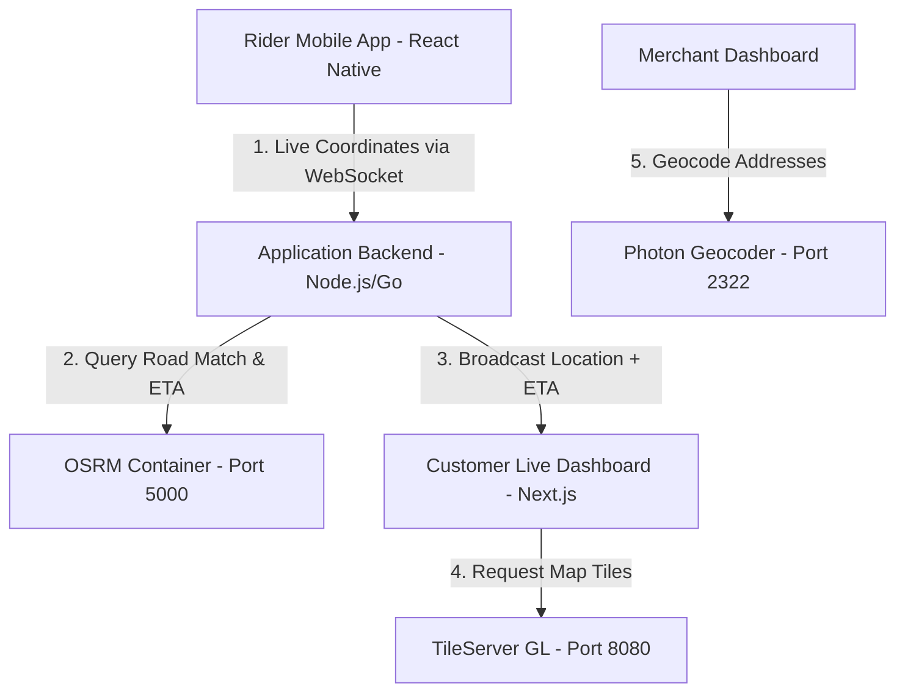

# Geospatial Delivery Tracker Integration Guide (Zomato-Style)

This guide details how to build a real-time **Delivery Agent Live Tracking & ETA Dashboard** (similar to Zomato, Swiggy, or Uber Eats) using your self-hosted geospatial stack:
* **TileServer GL** (Maharashtra maps)
* **OSRM** (Routing, ETA, and Snap-to-Road)
* **Photon** (Restaurant & Customer Address Search)

---

## 1. System Architecture

To track a delivery rider in real time and show the path on the map, you need three components:



---

## 2. API Endpoints Reference

### A. Geocoding (Search & Locate)
Use **Photon** to find coordinates of restaurants and customers during order checkout.

* **API Endpoint**: `https://geocode.testifysamples.com/api`
* **Example Query**:
  ```bash
  curl "https://geocode.testifysamples.com/api?q=Hinjewadi+Phase+1+Pune"
  ```
* **Response Payload (GeoJSON)**:
  ```json
  {
    "type": "FeatureCollection",
    "features": [
      {
        "type": "Feature",
        "geometry": {
          "type": "Point",
          "coordinates": [73.7384, 18.5912]
        },
        "properties": {
          "name": "Hinjewadi Phase 1",
          "city": "Pune",
          "state": "Maharashtra"
        }
      }
    ]
  }
  ```

### B. Routing & ETA
Use **OSRM** to calculate the initial delivery path, distance, and duration (ETA).

* **API Endpoint**: `https://routing.testifysamples.com/route/v1/driving/{restaurant_lng},{restaurant_lat};{customer_lng},{customer_lat}`
* **Query Parameters**:
  * `overview=full`: Returns the detailed polyline geometry.
  * `geometries=geojson`: Returns path in GeoJSON format.
* **Example Request**:
  ```bash
  curl "https://routing.testifysamples.com/route/v1/driving/73.7384,18.5912;73.8567,18.5204?overview=full&geometries=geojson"
  ```
* **Response**:
  ```json
  {
    "routes": [
      {
        "geometry": {
          "coordinates": [[73.7384, 18.5912], [73.7410, 18.5890], ..., [73.8567, 18.5204]],
          "type": "LineString"
        },
        "duration": 1420.5,
        "distance": 18200.3
      }
    ]
  }
  ```

### C. Snap-to-Road (GPS Correction)
Raw GPS tracking from mobile phones drifts. To make the rider marker stick smoothly to the street (instead of flying over buildings), pass the rider's recent GPS history to the OSRM **Match API**.

* **API Endpoint**: `https://routing.testifysamples.com/match/v1/driving/{lng1},{lat1};{lng2},{lat2};{lng3},{lat3}`
* **Example Request**:
  ```bash
  curl "https://routing.testifysamples.com/match/v1/driving/73.7380,18.5910;73.7385,18.5915;73.7390,18.5920?geometries=geojson"
  ```
* **Response**: Snaps coordinates directly to the street grid, correcting GPS errors.

---

## 3. Step-by-Step Implementation

### Step 1: Rider Mobile Tracking (React Native)
The rider's app polls coordinates and pushes updates to your server via WebSockets.

```typescript
import MapboxGL from '@maplibre/maplibre-react-native';
import { useEffect } from 'react';
import Geolocation from '@react-native-community/geolocation';

const WEBSOCKET_URL = "wss://your-backend-api.com/rider/live";

export function useRiderTracker(orderId: string, riderId: string) {
  useEffect(() => {
    const ws = new WebSocket(WEBSOCKET_URL);

    const watchId = Geolocation.watchPosition(
      (position) => {
        const { longitude, latitude, speed, heading } = position.coords;
        const payload = JSON.stringify({
          orderId,
          riderId,
          coords: [longitude, latitude],
          speed,
          heading,
          timestamp: Date.now()
        });
        
        if (ws.readyState === WebSocket.OPEN) {
          ws.send(payload);
        }
      },
      (error) => console.log("GPS Error: ", error),
      { enableHighAccuracy: true, distanceFilter: 10 } // Update every 10 meters
    );

    return () => {
      Geolocation.clearWatch(watchId);
      ws.close();
    };
  }, [orderId, riderId]);
}
```

### Step 2: Backend Broker (Node.js + WebSockets)
The backend intercepts rider updates, filters them using OSRM Map Matching, and broadcasts to the customer's dashboard.

```javascript
const WebSocket = require('ws');
const axios = require('axios');

const wss = new WebSocket.Server({ port: 8000 });
const OSRM_URL = "https://routing.testifysamples.com";

wss.on('connection', (ws) => {
  ws.on('message', async (message) => {
    const data = JSON.parse(message);
    const { orderId, coords, heading } = data;

    try {
      // 1. Get Snapped coordinates from OSRM Match API to remove GPS noise
      const matchRes = await axios.get(
        `${OSRM_URL}/match/v1/driving/${coords[0]},${coords[1]}?radius=25`
      );
      
      const snappedCoords = matchRes.data.matchings?.[0]?.geometry?.coordinates?.[0] || coords;

      // 2. Broadcast snapped location to customer socket pool
      broadcastToCustomers(orderId, {
        orderId,
        coords: snappedCoords,
        heading
      });
    } catch (err) {
      // Fallback to raw coords if OSRM match fails
      broadcastToCustomers(orderId, { orderId, coords, heading });
    }
  });
});
```

### Step 3: Next.js Live Map Dashboard (Customer View)
Renders a vector map styled from your self-hosted **TileServer GL**, with markers transitioning smoothly.

```tsx
import React, { useEffect, useRef, useState } from 'react';
import maplibre from 'maplibre-gl';
import 'maplibre-gl/dist/maplibre-gl.css';

interface DeliveryTrackerProps {
  restaurantCoords: [number, number]; // [lng, lat]
  customerCoords: [number, number];
}

export default function DeliveryTracker({ restaurantCoords, customerCoords }: DeliveryTrackerProps) {
  const mapContainer = useRef<HTMLDivElement>(null);
  const mapRef = useRef<maplibre.Map | null>(null);
  const riderMarkerRef = useRef<maplibre.Marker | null>(null);

  useEffect(() => {
    if (!mapContainer.current) return;

    // 1. Initialize self-hosted TileServer GL style
    const map = new maplibre.Map({
      container: mapContainer.current,
      style: "https://tiles.testifysamples.com/styles/basic-preview/style.json",
      center: restaurantCoords,
      zoom: 13
    });
    mapRef.current = map;

    map.on('load', async () => {
      // 2. Fetch routing path from OSRM
      const res = await fetch(
        `https://routing.testifysamples.com/route/v1/driving/${restaurantCoords.join(',')};${customerCoords.join(',')}?overview=full&geometries=geojson`
      );
      const routeData = await res.json();
      const routeCoordinates = routeData.routes[0].geometry.coordinates;

      // 3. Draw Route Line
      map.addSource('route', {
        type: 'geojson',
        data: {
          type: 'Feature',
          geometry: {
            type: 'LineString',
            coordinates: routeCoordinates
          }
        }
      });

      map.addLayer({
        id: 'route-line',
        type: 'line',
        source: 'route',
        paint: {
          'line-color': '#ff4d4f', // Red delivery path
          'line-width': 5,
          'line-opacity': 0.85
        }
      });

      // 4. Create markers for Restaurant & Customer
      new maplibre.Marker({ color: '#22c55e' }).setLngLat(restaurantCoords).addTo(map); // Green
      new maplibre.Marker({ color: '#3b82f6' }).setLngLat(customerCoords).addTo(map);   // Blue

      // 5. Create Rider Marker
      const riderEl = document.createElement('div');
      riderEl.className = 'rider-marker';
      riderEl.style.fontSize = '32px';
      riderEl.innerText = '🏍️'; // Custom rider icon

      const riderMarker = new maplibre.Marker({ element: riderEl })
        .setLngLat(restaurantCoords)
        .addTo(map);
      
      riderMarkerRef.current = riderMarker;
    });

    // 6. Connect to Live Location Broadcast WebSocket
    const ws = new WebSocket(`wss://your-backend-api.com/orders/track`);
    ws.onmessage = (event) => {
      const liveUpdate = JSON.parse(event.data);
      const { coords } = liveUpdate;
      
      // Update Rider Marker position dynamically on map
      if (riderMarkerRef.current) {
        riderMarkerRef.current.setLngLat(coords);
      }
    };

    return () => {
      ws.close();
      map.remove();
    };
  }, []);

  return <div ref={mapContainer} style={{ width: '100%', height: '500px', borderRadius: '12px' }} />;
}
```

---

## 4. Performance & Scale Optimizations

* **Cache Routing Queries**: Delivery routes don't change. Cache OSRM route paths in Redis based on `{restaurant_id}:{customer_hash}` to avoid querying the OSRM container repeatedly for every order update.
* **Throttle GPS Updates**: Send coordinates from the mobile app every 10–15 seconds or every 15 meters to minimize battery usage and reduce server compute overhead.
* **Geofence Check**: Use a simple distance check between the rider coordinate and restaurant/customer coordinates. If distance < 50 meters, trigger automatic status updates (e.g. "Rider reached restaurant" or "Order delivered").
