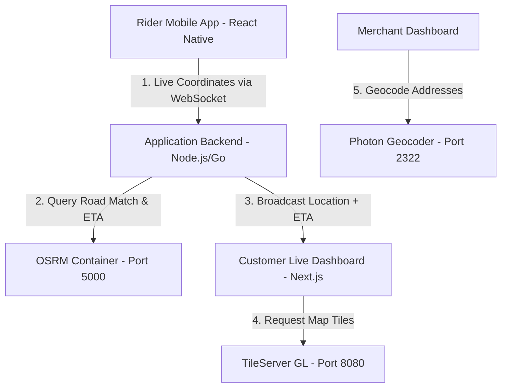

# Geospatial Delivery Tracker Integration Guide (Zomato-Style)

This guide details how to build a real-time **Delivery Agent Live Tracking & ETA Dashboard** (similar to Zomato, Swiggy, or Uber Eats) using your self-hosted geospatial stack:
* **TileServer GL** (Maharashtra maps)
* **OSRM** (Routing, ETA, and Snap-to-Road)
* **Photon** (Restaurant & Customer Address Search)

---

## 1. System Architecture

To track a delivery rider in real time and show the path on the map, you need three components:



## 2. API Endpoints Reference

All routing, tile serving, and geocoding services run **locally in your infrastructure**. There are **zero external dependencies** or third-party usage limits (no Google Maps or Mapbox billings).

### A. Geocoding & Reverse Geocoding (Photon)
Use **Photon** to find coordinates of locations, or get street names from coordinates.

* **Search Geocoding API**: `https://geocode.testifysamples.com/api?q={query}`
  * *Example*: `curl "https://geocode.testifysamples.com/api?q=Hinjewadi+Phase+1+Pune"`
* **Reverse Geocoding API**: `https://geocode.testifysamples.com/reverse?lon={lng}&lat={lat}`
  * *Example*: `curl "https://geocode.testifysamples.com/reverse?lon=73.8567&lat=18.5204"`

### B. Routing & ETA (OSRM)
Calculate path geometry, total distance, and duration (ETA) for delivery routing.

* **Route API**: `https://routing.testifysamples.com/route/v1/driving/{lng1},{lat1};{lng2},{lat2}`
  * *Example*: `curl "https://routing.testifysamples.com/route/v1/driving/73.7384,18.5912;73.8567,18.5204?overview=full&geometries=geojson"`

### C. Snap-to-Road Map Matching (OSRM)
Snap raw, noisy mobile GPS coordinate history to the actual road network grid.

* **Match API**: `https://routing.testifysamples.com/match/v1/driving/{lng1},{lat1};{lng2},{lat2};{lng3},{lat3}`
  * *Example*: `curl "https://routing.testifysamples.com/match/v1/driving/73.7380,18.5910;73.7385,18.5915;73.7390,18.5920?geometries=geojson"`

### D. Distance/Duration Matrix (OSRM)
Find the distance and time matrices between multiple delivery agents and multiple restaurant pickups. Ideal for finding the closest rider to assign.

* **Table API**: `https://routing.testifysamples.com/table/v1/driving/{rider1_lng},{rider1_lat};{rider2_lng},{rider2_lat};{pickup_lng},{pickup_lat}?sources=0;1&destinations=2`
  * *Example Request*:
    ```bash
    curl "https://routing.testifysamples.com/table/v1/driving/73.738,18.591;73.742,18.585;73.750,18.599?sources=0;1&destinations=2"
    ```
  * *Response*: Returns travel durations and distances from each rider (`0`, `1`) to the pickup point (`2`).

### E. Multi-Stop Route Optimization (OSRM)
Solves the Traveling Salesperson Problem (TSP) for batch deliveries. Optimizes the route sequence for a rider visiting multiple customer drop-offs.

* **Trip API**: `https://routing.testifysamples.com/trip/v1/driving/{pickup_lng},{pickup_lat};{drop1_lng},{drop1_lat};{drop2_lng},{drop2_lat}?source=first`
  * *Example*: `curl "https://routing.testifysamples.com/trip/v1/driving/73.738,18.591;73.745,18.588;73.752,18.595?source=first&geometries=geojson"`

### F. Pickup and Delivery Route Optimization (PDP API)
Solves the Pickup and Delivery Problem (PDP). It takes multiple locations (pickups and drops) and finds the absolute shortest route starting from the rider's position, ensuring that every pickup is visited before its corresponding dropoff.

* **API Endpoint**: `POST /api/optimize` (Exposed by your Next.js application at `http://localhost:3000/api/optimize`)
* **Request Body**:
  ```json
  {
    "rider": [72.8567, 18.5204],
    "orders": [
      {
        "id": "order-1",
        "pickup": [73.7384, 18.5912],
        "dropoff": [73.7452, 18.5880]
      },
      {
        "id": "order-2",
        "pickup": [73.7501, 18.5991],
        "dropoff": [73.7622, 18.6010]
      }
    ]
  }
  ```
* **Response Body**:
  ```json
  {
    "totalDistanceKm": 25.13,
    "totalDurationMin": 25.5,
    "stops": [
      { "type": "rider", "location": [72.8567, 18.5204] },
      { "type": "pickup", "orderId": "order-2", "location": [73.7501, 18.5991] },
      { "type": "pickup", "orderId": "order-1", "location": [73.7384, 18.5912] },
      { "type": "dropoff", "orderId": "order-1", "location": [73.7452, 18.5880] },
      { "type": "dropoff", "orderId": "order-2", "location": [73.7622, 18.6010] }
    ],
    "geometry": {
      "type": "LineString",
      "coordinates": [[72.8567, 18.5204], ...]
    },
    "visitOrder": [0, 2, 1, 3, 4]
  }
  ```

### G. Nearest Point Snapping (OSRM)
Snaps a coordinate to the nearest road segment and returns the metadata (name of the street, node ID).

* **Nearest API**: `https://routing.testifysamples.com/nearest/v1/driving/{lng},{lat}`
  * *Example*: `curl "https://routing.testifysamples.com/nearest/v1/driving/73.738,18.591"`

---

## 3. Step-by-Step Implementation

### Step 1: Rider Mobile Tracking (React Native)
The rider's app polls coordinates and pushes updates to your server via WebSockets.

```typescript
import MapboxGL from '@maplibre/maplibre-react-native';
import { useEffect } from 'react';
import Geolocation from '@react-native-community/geolocation';

const WEBSOCKET_URL = "wss://your-backend-api.com/rider/live";

export function useRiderTracker(orderId: string, riderId: string) {
  useEffect(() => {
    const ws = new WebSocket(WEBSOCKET_URL);

    const watchId = Geolocation.watchPosition(
      (position) => {
        const { longitude, latitude, speed, heading } = position.coords;
        const payload = JSON.stringify({
          orderId,
          riderId,
          coords: [longitude, latitude],
          speed,
          heading,
          timestamp: Date.now()
        });
        
        if (ws.readyState === WebSocket.OPEN) {
          ws.send(payload);
        }
      },
      (error) => console.log("GPS Error: ", error),
      { enableHighAccuracy: true, distanceFilter: 10 } // Update every 10 meters
    );

    return () => {
      Geolocation.clearWatch(watchId);
      ws.close();
    };
  }, [orderId, riderId]);
}
```

### Step 2: Backend Broker (Node.js + WebSockets)
The backend intercepts rider updates, filters them using OSRM Map Matching, and broadcasts to the customer's dashboard.

```javascript
const WebSocket = require('ws');
const axios = require('axios');

const wss = new WebSocket.Server({ port: 8000 });
const OSRM_URL = "https://routing.testifysamples.com";

wss.on('connection', (ws) => {
  ws.on('message', async (message) => {
    const data = JSON.parse(message);
    const { orderId, coords, heading } = data;

    try {
      // 1. Get Snapped coordinates from OSRM Match API to remove GPS noise
      const matchRes = await axios.get(
        `${OSRM_URL}/match/v1/driving/${coords[0]},${coords[1]}?radius=25`
      );
      
      const snappedCoords = matchRes.data.matchings?.[0]?.geometry?.coordinates?.[0] || coords;

      // 2. Broadcast snapped location to customer socket pool
      broadcastToCustomers(orderId, {
        orderId,
        coords: snappedCoords,
        heading
      });
    } catch (err) {
      // Fallback to raw coords if OSRM match fails
      broadcastToCustomers(orderId, { orderId, coords, heading });
    }
  });
});
```

### Step 3: Next.js Live Map Dashboard (Customer View)
Renders a vector map styled from your self-hosted **TileServer GL**, with markers transitioning smoothly.

```tsx
import React, { useEffect, useRef, useState } from 'react';
import maplibre from 'maplibre-gl';
import 'maplibre-gl/dist/maplibre-gl.css';

interface DeliveryTrackerProps {
  restaurantCoords: [number, number]; // [lng, lat]
  customerCoords: [number, number];
}

export default function DeliveryTracker({ restaurantCoords, customerCoords }: DeliveryTrackerProps) {
  const mapContainer = useRef<HTMLDivElement>(null);
  const mapRef = useRef<maplibre.Map | null>(null);
  const riderMarkerRef = useRef<maplibre.Marker | null>(null);

  useEffect(() => {
    if (!mapContainer.current) return;

    // 1. Initialize self-hosted TileServer GL style
    const map = new maplibre.Map({
      container: mapContainer.current,
      style: "https://tiles.testifysamples.com/styles/basic-preview/style.json",
      center: restaurantCoords,
      zoom: 13
    });
    mapRef.current = map;

    map.on('load', async () => {
      // 2. Fetch routing path from OSRM
      const res = await fetch(
        `https://routing.testifysamples.com/route/v1/driving/${restaurantCoords.join(',')};${customerCoords.join(',')}?overview=full&geometries=geojson`
      );
      const routeData = await res.json();
      const routeCoordinates = routeData.routes[0].geometry.coordinates;

      // 3. Draw Route Line
      map.addSource('route', {
        type: 'geojson',
        data: {
          type: 'Feature',
          geometry: {
            type: 'LineString',
            coordinates: routeCoordinates
          }
        }
      });

      map.addLayer({
        id: 'route-line',
        type: 'line',
        source: 'route',
        paint: {
          'line-color': '#ff4d4f', // Red delivery path
          'line-width': 5,
          'line-opacity': 0.85
        }
      });

      // 4. Create markers for Restaurant & Customer
      new maplibre.Marker({ color: '#22c55e' }).setLngLat(restaurantCoords).addTo(map); // Green
      new maplibre.Marker({ color: '#3b82f6' }).setLngLat(customerCoords).addTo(map);   // Blue

      // 5. Create Rider Marker
      const riderEl = document.createElement('div');
      riderEl.className = 'rider-marker';
      riderEl.style.fontSize = '32px';
      riderEl.innerText = '🏍️'; // Custom rider icon

      const riderMarker = new maplibre.Marker({ element: riderEl })
        .setLngLat(restaurantCoords)
        .addTo(map);
      
      riderMarkerRef.current = riderMarker;
    });

    // 6. Connect to Live Location Broadcast WebSocket
    const ws = new WebSocket(`wss://your-backend-api.com/orders/track`);
    ws.onmessage = (event) => {
      const liveUpdate = JSON.parse(event.data);
      const { coords } = liveUpdate;
      
      // Update Rider Marker position dynamically on map
      if (riderMarkerRef.current) {
        riderMarkerRef.current.setLngLat(coords);
      }
    };

    return () => {
      ws.close();
      map.remove();
    };
  }, []);

  return <div ref={mapContainer} style={{ width: '100%', height: '500px', borderRadius: '12px' }} />;
}
```

---

## 4. Performance & Scale Optimizations

* **Cache Routing Queries**: Delivery routes don't change. Cache OSRM route paths in Redis based on `{restaurant_id}:{customer_hash}` to avoid querying the OSRM container repeatedly for every order update.
* **Throttle GPS Updates**: Send coordinates from the mobile app every 10–15 seconds or every 15 meters to minimize battery usage and reduce server compute overhead.
* **Geofence Check**: Use a simple distance check between the rider coordinate and restaurant/customer coordinates. If distance < 50 meters, trigger automatic status updates (e.g. "Rider reached restaurant" or "Order delivered").

---

## 5. React Native Mobile Integration Examples

Here are complete React Native components demonstrating how to build a **Save Address Location Picker** and a **Live Delivery Tracker Screen** using MapLibre React Native and your self-hosted API endpoints.

### A. Location Picker / Save Address Screen
This component lets users search for an address via the **Photon Geocoding API**, pan the map to the selected coordinate, or drop a custom pin via **long press** to trigger reverse-geocoding to display and save the address.

```typescript
import React, { useState, useRef } from 'react';
import { StyleSheet, View, Text, TextInput, FlatList, TouchableOpacity, Alert } from 'react-native';
import MapLibreGL from '@maplibre/maplibre-react-native';
import { MapClient } from '@tetsifymaps/core';

// Disable standard Mapbox API access token for local self-hosted tiles
MapLibreGL.setAccessToken(null);

const TILE_STYLE_URL = "https://tiles.testifysamples.com/styles/basic-preview/style.json";
const GEOCODING_URL = "https://geocode.testifysamples.com";

export default function AddressPickerScreen() {
  const [searchQuery, setSearchQuery] = useState('');
  const [searchResults, setSearchResults] = useState<any[]>([]);
  const [selectedCoords, setSelectedCoords] = useState<[number, number] | null>(null);
  const [formattedAddress, setFormattedAddress] = useState('');
  
  const mapClient = useRef(new MapClient({ geocodeUrl: GEOCODING_URL }));
  const cameraRef = useRef<MapLibreGL.Camera>(null);

  // 1. Fetch search suggestions from Photon Geocoder API
  const handleSearch = async (text: string) => {
    setSearchQuery(text);
    if (text.length > 2) {
      try {
        const results = await mapClient.current.searchLandmarks(text);
        setSearchResults(results);
      } catch (err) {
        console.error("Geocoding search failed:", err);
      }
    } else {
      setSearchResults([]);
    }
  };

  // 2. Center map and set selected address details
  const handleSelectLocation = (feature: any) => {
    const coords = feature.geometry.coordinates; // [lng, lat]
    setSelectedCoords(coords);
    
    const addr = feature.properties.name || "Selected Location";
    const fullAddr = [feature.properties.street, feature.properties.city, feature.properties.state, feature.properties.country]
      .filter(Boolean)
      .join(', ');
    
    setFormattedAddress(fullAddr ? `${addr}, ${fullAddr}` : addr);
    setSearchResults([]);
    setSearchQuery(addr);

    // Pan camera to the location coordinate
    cameraRef.current?.setCamera({
      centerCoordinate: coords,
      zoomLevel: 15,
      animationDuration: 1000
    });
  };

  // 3. Handle manual pin drop on map long press (triggers reverse geocoding)
  const handleMapLongPress = async (event: any) => {
    const coords = event.geometry.coordinates; // [lng, lat]
    setSelectedCoords(coords);

    try {
      const feature = await mapClient.current.reverseGeocode(coords[0], coords[1]);
      if (feature) {
        const addr = feature.properties.name || "Pinned Location";
        const fullAddr = [feature.properties.street, feature.properties.city, feature.properties.state, feature.properties.country]
          .filter(Boolean)
          .join(', ');
        setFormattedAddress(fullAddr ? `${addr}, ${fullAddr}` : addr);
        setSearchQuery(addr);
      } else {
        setFormattedAddress(`Pinned at: ${coords[0].toFixed(5)}, ${coords[1].toFixed(5)}`);
      }
    } catch (err) {
      setFormattedAddress(`Pinned at: ${coords[0].toFixed(5)}, ${coords[1].toFixed(5)}`);
    }
  };

  const handleSaveAddress = () => {
    if (!selectedCoords) return;
    Alert.alert("Address Saved Successfully", `Address:\n${formattedAddress}\n\nCoords: ${selectedCoords}`);
  };

  return (
    <View style={styles.container}>
      {/* Self-Hosted Map Component */}
      <MapLibreGL.MapView
        style={styles.map}
        styleURL={TILE_STYLE_URL}
        onLongPress={handleMapLongPress}
        logoEnabled={false}
        attributionEnabled={false}
      >
        <MapLibreGL.Camera
          ref={cameraRef}
          zoomLevel={12}
          centerCoordinate={[72.8777, 19.0760]} // Mumbai default center
        />
        
        {selectedCoords && (
          <MapLibreGL.PointAnnotation id="selectedPin" coordinate={selectedCoords}>
            <View style={styles.pin}>
              <Text style={styles.pinIcon}>📍</Text>
            </View>
          </MapLibreGL.PointAnnotation>
        )}
      </MapLibreGL.MapView>

      {/* Floating Address Search */}
      <View style={styles.searchContainer}>
        <TextInput
          style={styles.searchInput}
          placeholder="Search address or landmark..."
          placeholderTextColor="#888"
          value={searchQuery}
          onChangeText={handleSearch}
        />
        {searchResults.length > 0 && (
          <FlatList
            data={searchResults}
            keyExtractor={(item) => item.properties.osm_id.toString()}
            style={styles.resultsList}
            renderItem={({ item }) => (
              <TouchableOpacity style={styles.resultItem} onPress={() => handleSelectLocation(item)}>
                <Text style={styles.resultText}>{item.properties.name}</Text>
                <Text style={styles.resultSubtext}>{item.properties.city || item.properties.state}</Text>
              </TouchableOpacity>
            )}
          />
        )}
      </View>

      {/* Confirm Selection Footer */}
      {selectedCoords && (
        <View style={styles.footer}>
          <Text style={styles.addressLabel}>DELIVER TO:</Text>
          <Text style={styles.addressText} numberOfLines={2}>{formattedAddress}</Text>
          <TouchableOpacity style={styles.saveButton} onPress={handleSaveAddress}>
            <Text style={styles.saveButtonText}>Confirm & Save Address</Text>
          </TouchableOpacity>
        </View>
      )}
    </View>
  );
}

const styles = StyleSheet.create({
  container: { flex: 1 },
  map: { flex: 1 },
  pin: { width: 30, height: 30, justifyContent: 'center', alignItems: 'center' },
  pinIcon: { fontSize: 28 },
  searchContainer: { position: 'absolute', top: 50, left: 16, right: 16, zIndex: 10 },
  searchInput: { backgroundColor: '#ffffff', padding: 12, borderRadius: 8, elevation: 4, color: '#333' },
  resultsList: { backgroundColor: '#ffffff', borderRadius: 8, marginTop: 4, maxHeight: 200, elevation: 4 },
  resultItem: { padding: 12, borderBottomWidth: 0.5, borderBottomColor: '#eee' },
  resultText: { fontSize: 14, fontWeight: 'bold', color: '#333' },
  resultSubtext: { fontSize: 12, color: '#666', marginTop: 2 },
  footer: { position: 'absolute', bottom: 0, left: 0, right: 0, backgroundColor: '#ffffff', padding: 20, borderTopLeftRadius: 16, borderTopRightRadius: 16, elevation: 8 },
  addressLabel: { fontSize: 12, fontWeight: 'bold', color: '#888' },
  addressText: { fontSize: 14, color: '#333', marginTop: 4, marginBottom: 12 },
  saveButton: { backgroundColor: '#6366f1', padding: 14, borderRadius: 8, alignItems: 'center' },
  saveButtonText: { color: '#fff', fontSize: 16, fontWeight: 'bold' }
});
```

### B. Customer Live Delivery Tracking Screen
This component connects to the WebSocket broker to track the delivery rider's location in real time, overlays the restaurant and customer coordinates, and renders the OSRM route path.

```typescript
import React, { useEffect, useState, useRef } from 'react';
import { StyleSheet, View, Text } from 'react-native';
import MapLibreGL from '@maplibre/maplibre-react-native';

MapLibreGL.setAccessToken(null);

const TILE_STYLE_URL = "https://tiles.testifysamples.com/styles/basic-preview/style.json";
const ROUTING_URL = "https://routing.testifysamples.com";

interface LiveTrackerProps {
  orderId: string;
  restaurantCoords: [number, number]; // [lng, lat]
  customerCoords: [number, number];   // [lng, lat]
}

export default function LiveDeliveryTrackerScreen({ orderId, restaurantCoords, customerCoords }: LiveTrackerProps) {
  const [riderCoords, setRiderCoords] = useState<[number, number]>(restaurantCoords);
  const [routeGeojson, setRouteGeojson] = useState<any>(null);
  const cameraRef = useRef<MapLibreGL.Camera>(null);

  useEffect(() => {
    // 1. Fetch travel path from OSRM
    const fetchRoute = async () => {
      try {
        const response = await fetch(
          `${ROUTING_URL}/route/v1/driving/${restaurantCoords.join(',')};${customerCoords.join(',')}?overview=full&geometries=geojson`
        );
        const data = await response.json();
        if (data.routes && data.routes.length > 0) {
          setRouteGeojson(data.routes[0].geometry);
        }
      } catch (err) {
        console.error("Failed to load delivery route:", err);
      }
    };
    fetchRoute();

    // 2. Connect to the Websocket stream for live location coordinates
    const ws = new WebSocket(`wss://your-backend-api.com/orders/track`);
    
    ws.onmessage = (event) => {
      const update = JSON.parse(event.data);
      if (update.orderId === orderId && update.coords) {
        setRiderCoords(update.coords); // Dynamic updates update rider pin position
      }
    };

    return () => ws.close();
  }, [orderId]);

  return (
    <View style={styles.container}>
      <MapLibreGL.MapView
        style={styles.map}
        styleURL={TILE_STYLE_URL}
        logoEnabled={false}
        attributionEnabled={false}
      >
        <MapLibreGL.Camera
          ref={cameraRef}
          zoomLevel={13}
          centerCoordinate={restaurantCoords}
        />

        {/* Route Line overlay */}
        {routeGeojson && (
          <MapLibreGL.ShapeSource id="routeSource" shape={routeGeojson}>
            <MapLibreGL.LineLayer
              id="routeLine"
              style={{
                lineColor: '#ff4d4f', // Red route path
                lineWidth: 5,
                lineCap: 'round',
                lineJoin: 'round'
              }}
            />
          </MapLibreGL.ShapeSource>
        )}

        {/* Merchant/Restaurant marker */}
        <MapLibreGL.PointAnnotation id="restaurantPin" coordinate={restaurantCoords}>
          <View style={[styles.markerBg, styles.greenBg]}>
            <Text style={styles.markerText}>🍳</Text>
          </View>
        </MapLibreGL.PointAnnotation>

        {/* Customer destination marker */}
        <MapLibreGL.PointAnnotation id="customerPin" coordinate={customerCoords}>
          <View style={[styles.markerBg, styles.blueBg]}>
            <Text style={styles.markerText}>🏠</Text>
          </View>
        </MapLibreGL.PointAnnotation>

        {/* Live Rider Marker */}
        <MapLibreGL.PointAnnotation id="riderPin" coordinate={riderCoords}>
          <View style={styles.riderPin}>
            <Text style={styles.riderText}>🏍️</Text>
          </View>
        </MapLibreGL.PointAnnotation>
      </MapLibreGL.MapView>
    </View>
  );
}

const styles = StyleSheet.create({
  container: { flex: 1 },
  map: { flex: 1 },
  markerBg: { width: 32, height: 32, borderRadius: 16, justifyContent: 'center', alignItems: 'center', borderWidth: 2, borderColor: '#fff' },
  greenBg: { backgroundColor: '#22c55e' },
  blueBg: { backgroundColor: '#3b82f6' },
  markerText: { fontSize: 16 },
  riderPin: { width: 36, height: 36, backgroundColor: '#0f172a', borderRadius: 18, justifyContent: 'center', alignItems: 'center', borderWidth: 2, borderColor: '#fff' },
  riderText: { fontSize: 20 }
});
```

