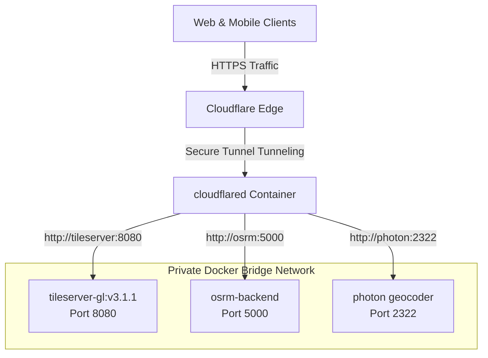

# 🗺️ TetsifyMaps: Self-Hosted Mapping Infrastructure

TetsifyMaps is a production-ready, self-hosted geospatial mapping, geocoding, and routing infrastructure designed to run efficiently on an Ubuntu server (minimum **2 vCPU, 16GB RAM**) with a strict idle memory footprint **< 10GB RAM**.

The stack orchestrates three containerized engines linked through a private Docker bridge network and securely exposed to the internet via **Cloudflare Tunnels (`cloudflared`)**—removing the need to expose open ports or configure complex Nginx reverse proxies with SSL certificates.

---

## 🏛️ System Architecture



*   **Tile Engine (`maptiler/tileserver-gl`)**: Serves vector map tiles and GL style JSONs from pre-rendered `.mbtiles` packages.
*   **Routing Engine (`project-osrm/osrm-backend`)**: Resolves high-speed routing, distance matrices, and Traveling Salesperson Problem (TSP) optimization queries up to 30 stops using the **Multi-Level Dijkstra (MLD)** algorithm.
*   **Geocoding Engine (`komoot/photon`)**: Handles fast "search-as-you-type" address autocomplete and reverse geocoding from mobile GPS coordinates.
*   **Ingress (`cloudflare/cloudflared`)**: Establishes outbound TLS connections to Cloudflare, forwarding specific subdomains directly to internal service containers.

---

## 📂 Repository Structure

```text
├── infra/
│   ├── docker-compose.yml     # Container orchestration configuration
│   ├── setup-data.sh          # Data download & OSRM compilation bootstrap script
│   └── data/                  # Shared data volume (created during setup)
│       ├── photon_data/       # Photon Lucene search indexes
│       ├── Zurich.osm.pbf     # Raw OpenStreetMap XML data
│       ├── Zurich.osrm*       # Processed OSRM routing tables
│       └── zurich_switzerland.mbtiles # Vector map tiles
├── packages/
│   └── map-core/              # Shared TypeScript mapping client SDK
│       ├── src/index.ts       # SDK containing geocoding & OSRM endpoints
│       └── dist/              # Compiled SDK JavaScript files
├── examples/
│   ├── nextjs-map/            # Interactive Map & Route Planner web application
│   └── react-native-map/      # React Native Maplibre mobile integration
└── README.md                  # System Deployment & Integration Guide
```

---

## 🚀 Step-by-Step Deployment Guide

### Step 1: Clone the Repository & Configure Data
Log into your target Ubuntu server and run the data preparation script. It downloads sample vector tiles (Zürich, Switzerland), geocoding indexes (Switzerland), and processes the OSRM routing graph directly inside standard Docker containers (meaning **no host-level compiler dependencies** are required).

```bash
cd infra/
./setup-data.sh
```

> [!NOTE]
> The default region is set to **Zurich, Switzerland** to provide a fully consistent dataset where tiles, routing, and search align perfectly. 
> To switch regions, edit the `REGION` and `COUNTRY_CODE` parameters at the top of `setup-data.sh` and point them to your target Geofabrik/GraphHopper extracts.

---

### Step 2: Configure Cloudflare Tunnels (Zero-Port Exposure)

Cloudflare Tunnels create a secure connection between your server and the Cloudflare Edge network without exposing open ports or public IPs.

1.  **Install Cloudflare CLI on your local machine** (or server):
    ```bash
    curl -L https://github.com/cloudflare/cloudflared/releases/latest/download/cloudflared-linux-amd64 -o /usr/local/bin/cloudflared
    chmod +x /usr/local/bin/cloudflared
    ```
2.  **Authenticate cloudflared** with your Cloudflare account:
    ```bash
    cloudflared tunnel login
    ```
3.  **Create your Tunnel**:
    ```bash
    cloudflared tunnel create tetsify-maps-tunnel
    ```
    This command generates a tunnel UUID and a credentials file (`~/.cloudflare/YOUR_TUNNEL_UUID.json`). Note down this UUID.
4.  **Route subdomains to your Tunnel** (in the Cloudflare Dashboard or via CLI):
    ```bash
    cloudflared tunnel route dns tetsify-maps-tunnel tiles.yourdomain.com
    cloudflared tunnel route dns tetsify-maps-tunnel geocode.yourdomain.com
    cloudflared tunnel route dns tetsify-maps-tunnel routing.yourdomain.com
    ```
5.  **Configure Ingress Rules**:
    Create a local configuration file in Cloudflare (or manage mappings in the **Cloudflare Zero Trust Dashboard** under *Access -> Tunnels*).
    
    If mapping via the Zero Trust Dashboard, set up the public hostnames to route to the internal Docker container service names:
    *   `https://tiles.yourdomain.com` ➔ `http://tileserver:8080`
    *   `https://geocode.yourdomain.com` ➔ `http://photon:2322`
    *   `https://routing.yourdomain.com` ➔ `http://osrm:5000`

---

### Step 3: Run the Mapping Stack
Export your Cloudflare Tunnel Token (available in the Zero Trust dashboard or generated credentials) and boot the Docker Compose stack.

```bash
# In the infra/ directory
export TUNNEL_TOKEN="your_cloudflare_tunnel_token_here"
docker compose up -d
```

Verify that all systems are running and healthy:
```bash
docker compose ps
```
The health checks will monitor the endpoints, marking containers as `healthy` once their respective databases are loaded into memory.

---

## 🛠️ Software Integration

### 1. Core SDK (`/packages/map-core`)
The shared TypeScript client provides a type-safe wrapper to interact with the container endpoints. It exports:
*   `searchLandmarks(query, focusCoords)`: Landmark autocomplete with optional location bias.
*   `reverseGeocode(lng, lat)`: Reverse geocoding of GPS coordinates.
*   `calculateMultiStopTrip(points, optimize)`: Routing. Set `optimize = true` to run OSRM's TSP solver.

#### SDK Building
```bash
cd packages/map-core
npm install
npm run build
```

---

### 2. Next.js Integration (`/examples/nextjs-map`)
The Next.js integration provides a map dashboard using `maplibre-gl`.

#### Configuration
Create a `.env.local` inside `examples/nextjs-map/`:
```env
NEXT_PUBLIC_MAP_TILE_URL=https://tiles.yourdomain.com/styles/basic/style.json
NEXT_PUBLIC_GEOCODE_URL=https://geocode.yourdomain.com
NEXT_PUBLIC_ROUTING_URL=https://routing.yourdomain.com
```

#### Running Next.js Web App
```bash
cd examples/nextjs-map
npm install
npm run dev
```
Open [http://localhost:3000](http://localhost:3000) to plan routes, drop stops, search points, and run the TSP optimizer.

---

### 3. React Native Mobile Integration (`/examples/react-native-map`)
The mobile component (`MapScreen.tsx`) uses `@maplibre/maplibre-react-native` to render the self-hosted map tiles on Android and iOS.

#### Installation Instructions
1.  Add the dependencies to your React Native app:
    ```bash
    npm install @maplibre/maplibre-react-native
    # Link local package
    npm install ../path/to/packages/map-core
    ```
2.  **iOS Configuration**:
    Add the location description to `ios/YourAppName/Info.plist`:
    ```xml
    <key>NSLocationWhenInUseUsageDescription</key>
    <string>We need your location to calculate routes from your current position.</string>
    ```
3.  **Android Configuration**:
    Add permissions to `android/app/src/main/AndroidManifest.xml`:
    ```xml
    <uses-permission android:name="android.permission.ACCESS_FINE_LOCATION" />
    <uses-permission android:name="android.permission.ACCESS_COARSE_LOCATION" />
    ```

---

## 🧠 Memory Capping & Production Tuning

To keep idle consumption strictly **under 10GB RAM** for a 16GB server:

1.  **Photon JVM Tuning**:
    Photon runs on OpenSearch/Lucene which is memory intensive. In `docker-compose.yml`, it is capped at a maximum 4GB heap allocation:
    ```yaml
    environment:
      - JAVA_OPTS=-Xms1g -Xmx4g -XX:+UseG1GC
    ```
2.  **OSRM Algorithm Selection**:
    OSRM runs using Multi-Level Dijkstra (`mld`) instead of Contraction Hierarchies (`ch`). While MLD routing calculations are slightly slower (fractions of a millisecond difference), the pre-processing memory overhead and memory footprint of the loaded routing tables are significantly smaller (under 200MB for a medium city, compared to gigabytes required by CH).
3.  **TileServer GL Caching**:
    TileServer GL is lightweight. Caches are managed internally to avoid memory leaks. Idle memory consumption is less than 150MB.
